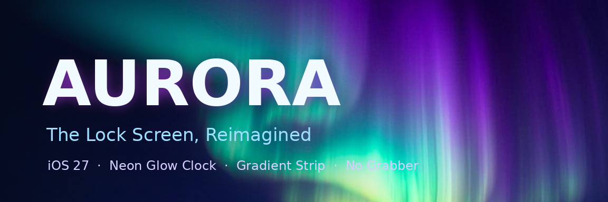

# Aurora — The Lock Screen, Reimagined

A jailbreak tweak for **iOS 27** (and iOS 16+) that gives your lock screen a
neon aurora makeover.



> Built for the **vphone-cli** (Lakr233) jailbroken iOS 27.0.1 VM, but works on
> any iOS 16+ jailbreak. Ships as both **rootful** and **roothide** packages.

## Features

| Feature | What it does |
|---|---|
| **Neon Glow Clock** | Applies a colored outer glow to every glyph layer of the iOS 16+/27 lock screen clock (`UIClockView`) and retints it via `UIClockFaceConfiguration` when available. Hue 0–360, glow 0–100. |
| **Aurora Strip** | A floating gradient-text banner injected right under the clock (`CATextLayer` masked by a `CAGradientLayer` — real gradient text, zero UIKit fighting). Fully custom text. |
| **Hide Home Grabber** | Hides the bottom grabber bar on the lock screen (hooks both `SBDashBoardGrabberView` and `SBFLockScreenGrabberView`, so it survives version differences). |
| **Settings in Settings.app** | PreferenceLoader bundle (`AuroraPrefs`) with switches, sliders and an editable text field. Changes apply **live** via Darwin notifications — no respring needed. An *Apply & Respring* button is included anyway. |

## Install

No `.deb` files are committed here — **GitHub Actions builds them for you** on
every push and publishes them to a rolling [**Latest build** release](https://github.com/randomdud7/aurora/releases/tag/latest).
The links in this README always serve the newest build.

### Step 1 — Put this repo on GitHub (one-time, ~2 minutes)

1. Unzip `aurora-repo.zip` on your Mac.
2. Go to **github.com/new** → name the repo `aurora` → **Create repository**.
3. Click **"uploading an existing file"** and drag in the **contents** of the
   unzipped folder. Press `⌘ ⇧ .` in Finder first — the hidden
   **`.github`** folder must be included (it holds the build workflow).
4. Click **Commit changes**, then open the **Actions** tab and wait ~3 minutes
   for **Build debs** to turn green. It compiles both packages and publishes
   them to the [Latest build release](https://github.com/randomdud7/aurora/releases/tag/latest).

> Already built the debs locally? You can skip CI — go to
> **Releases → Draft a new release**, tag it `latest`, and drag your `.deb`
> files in. The download links below work either way.

### Step 2 — Download the .deb inside the VM

Open this in Safari **inside the VM** (or tap the links in the table):

| Your bootstrap | Download |
|---|---|
| Rootful (unc0ver / checkra1n / jb CFW with stock Sileo) | [`aurora-rootful.deb`](https://github.com/randomdud7/aurora/releases/latest/download/aurora-rootful.deb) |
| roothide (Irisin / OwnGoal bootstrap — vphone's default package env) | [`aurora-roothide.deb`](https://github.com/randomdud7/aurora/releases/latest/download/aurora-roothide.deb) |

```
https://github.com/randomdud7/aurora/releases/latest/download/aurora-rootful.deb
```

Not sure which build? Try **rootful first** — Sileo will simply refuse the one
that doesn't match your bootstrap, then swap to the roothide build.

### Step 3 — Install it in Sileo

> **Newer Sileo versions no longer have a "Downloads" tab.** Install a local
> .deb like this instead:

1. Safari downloads the `.deb` (tap the **download arrow** in the address bar
   to find it).
2. Tap the downloaded file → it opens a preview → tap the **Share** button →
   **Copy to Sileo**. Sileo opens with an install prompt → **Install**.
   *(If there's no "Copy to Sileo" option, open **Filza**, navigate to Safari's
   downloads folder, tap the .deb → Install.)*
3. Respring when asked. Done — check **Settings → Aurora**.

### Via SSH (alternative)

```bash
scp aurora-rootful.deb root@<vm-ip>:/var/mobile/
ssh root@<vm-ip> "dpkg -i /var/mobile/aurora-rootful.deb && killall -9 SpringBoard"
```

> Rootful installs to `/Library/MobileSubstrate` + `/Library/PreferenceBundles`.
> roothide installs under the hidden `jbroot` prefix. Match the package scheme
> to your bootstrap.

## Build it yourself

### Local (Theos)

Requires [Theos](https://theos.dev) with an iOS SDK (16.5 SDK works fine for
targeting iOS 27 — frameworks are forward-compatible).

```bash
export THEOS=~/theos
make package FINALPACKAGE=1
# -> packages/com.aurora.lockscreen_1.0.0_iphoneos-arm.deb

# roothide variant (jbroot-relocatable, no roothide-theos needed):
bash scripts/make_roothide.sh packages/com.aurora.lockscreen_1.0.0_iphoneos-arm.deb aurora-roothide.deb
```

### GitHub Actions (zero setup)

Any push to `main` triggers **Build debs** (`.github/workflows/build.yml`),
which builds **both** packages on a clean runner and:

- uploads them as workflow **artifacts** (Actions tab → latest run),
- publishes/refreshes the rolling [**Latest build** release](https://github.com/randomdud7/aurora/releases/tag/latest) —
  this is what the install links above point to.

Pushing a tag like `v1.0.1` additionally creates a versioned
[Release](https://github.com/randomdud7/aurora/releases) with both debs
attached — the easiest way to keep permanent install links.

## Project layout

```
├── Makefile                  # root aggregate (tweak + prefs bundle)
├── control                   # deb metadata (package: com.aurora.lockscreen)
├── Aurora.plist              # substrate filter → com.apple.springboard
├── Tweak.x                   # all the Logos hooks (~260 lines)
├── layout/Library/PreferenceLoader/Preferences/Aurora.plist
├── auroraprefs/
│   ├── Makefile              # preference bundle subproject
│   ├── RootListController.h/.m
│   └── Resources/
│       ├── Info.plist
│       └── Root.plist        # switches / sliders / text field / respring
└── scripts/
    └── make_roothide.sh      # rootful → roothide (jbroot) converter
```

## Settings

Everything lives in **Settings → Aurora**:

- **Enable Aurora** — master switch
- **Clock Hue** (0–360) — neon glow + clock tint color
- **Neon Glow** (0–100) — glow strength
- **Hide Home Grabber**
- **Show Aurora Strip** + **Strip Text** + **Strip Gradient Hue**

Prefs are read from the `com.aurora.lockscreen` defaults domain; every
specifier posts the `com.aurora.lockscreen/prefs.changed` Darwin notification,
so the tweak reloads itself while you drag the sliders.

## Troubleshooting

- **Clock looks stock** → the glow only touches layers with rendered glyph
  content; on some firmware builds the clock lives in a slightly different
  class. The `UIClockFaceConfiguration` retint hook covers the other path.
- **Prefs page missing** → confirm
  `/Library/PreferenceLoader/Preferences/Aurora.plist` and
  `/Library/PreferenceBundles/AuroraPrefs.bundle` exist (roothide: inside
  jbroot). Then `uicache` + respring.
- **SpringBoard crash-loop** → boot the VM in safe mode, or over SSH:
  `dpkg -r com.aurora.lockscreen`, then respring.

## License

MIT — see [LICENSE](LICENSE). For research/educational use on your own devices
and VMs.
